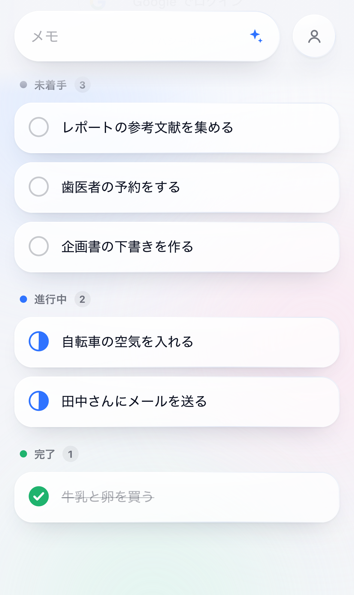
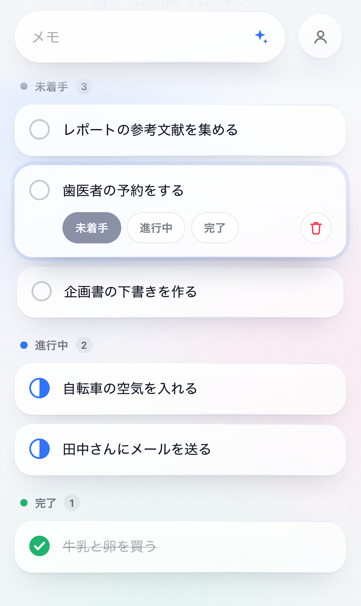
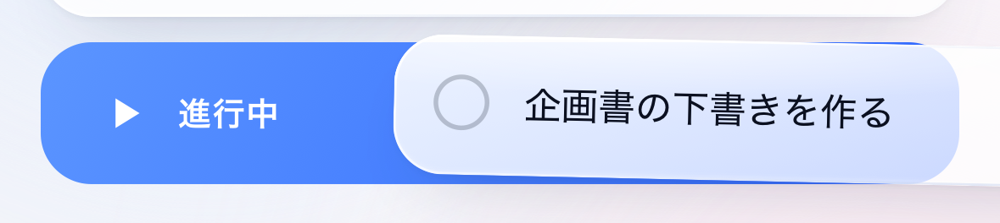

# Flick

開いた瞬間にメモでき、カードを指で払って状態を変えるタスク管理の Web アプリ。

- 公開先：https://flick.formesartart.workers.dev
- 技術の選び方と理由：[docs/TECH_CHOICES.md](docs/TECH_CHOICES.md)
- プライバシーポリシー：https://flick.formesartart.workers.dev/privacy

<p>
  
  
</p>
<p></p>

## 使い方

| 操作 | 結果 |
| --- | --- |
| 上の入力欄に書いて Enter | タスクになる（改行すると行ごとに分かれる） |
| ✦ | 長いメモ（音声入力など）を AI が実行できるタスクに分ける |
| カードを右へ払う | 未着手 → 進行中 → 完了 → 削除 |
| カードを左へ払う | 完了 → 進行中 → 未着手 |
| 左の丸 | 次の状態へ |
| カードを押す | 書き換え・状態の選択・削除 |
| 通知の「元に戻す」 | 直前の操作を取り消す |
| 右上の丸 | ログアウト・アカウントの削除 |

## 構成

```
index.html          入力欄とスケルトン（JavaScript を待たずに出る）
public/boot.js      入力欄を最初から動かす小さなスクリプト
public/sw.js        2 回目から通信なしで開くための Service Worker
src/                画面（React + Motion）
worker/             API（Cloudflare Workers + Hono）
shared/             画面と API で共通の型
migrations/         D1 の表の定義
tests/              Playwright のテスト
```

## 手元で動かす

```bash
npm install
cp .dev.vars.example .dev.vars
npm run db:migrate:local
npm run dev
```

手元では `/api/auth/dev` でテスト用のログインができる（`.dev.vars` に `DEV_LOGIN=1` があるときだけ）。

## テスト

```bash
npm test
```

ビルドしたものを `wrangler dev` で動かし、iPhone（WebKit）・Android（Chromium）・パソコン（Chrome）の 3 種類のブラウザで操作して確かめる（33 項目 × 3 種類）。

```bash
npm run test:prod
```

公開中のサイトを、同じ 3 種類のブラウザで確かめる（ログインなしで確かめられる 6 項目）。

## 公開

```bash
npm run db:migrate:remote
npm run deploy
```

## Google ログインの設定（済み）

Google Cloud のプロジェクト「Flick」に、OAuth クライアント（ウェブ アプリケーション）を作ってある。公開ステータスは「本番環境」。

- 承認済みの JavaScript 生成元：`https://flick.formesartart.workers.dev`
- 承認済みのリダイレクト URI：`https://flick.formesartart.workers.dev/api/auth/google`
- クライアント ID は `wrangler.jsonc` の `GOOGLE_CLIENT_ID`（公開してよい値）。クライアント シークレットは使わない。
- 手元では `.dev.vars` で `GOOGLE_CLIENT_ID` を空にして、Google のボタンを読み込まない（テスト用のログインを使う）。
